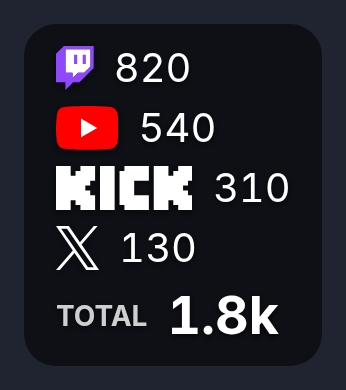
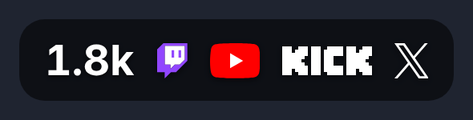

[English](README.md) | Español

# Stream Viewers Counter

Muestra cuántas personas están viendo tu stream en vivo, directamente en pantalla en OBS.

Ves un ícono y un contador por cada plataforma (Twitch, YouTube, Kick y X), además de un **Total**. Cuando nadie está en vivo, el overlay es invisible.

 

## Qué necesitas

- [OBS](https://obsproject.com) (gratis)
- [Streamer.bot](https://streamer.bot) (gratis)
- Tus cuentas de [Twitch](https://www.twitch.tv), [YouTube](https://www.youtube.com), [Kick](https://kick.com) y/o [X](https://x.com)

## Descarga

Descarga estos dos archivos:

- [overlay.html](https://github.com/AndryOre/stream-viewers-counter/releases/latest/download/overlay.html)
- [x-poller.cs](https://github.com/AndryOre/stream-viewers-counter/releases/latest/download/x-poller.cs) (solo lo necesitas si quieres X)

Guárdalos en un lugar donde no los vayas a borrar.

## Paso 1: Enciende el servidor de Streamer.bot

1. En Streamer.bot, abre **Servers/Clients** y elige **WebSocket Server** (el nombre exacto que ves en el menú).
2. Deja la dirección y el puerto que vienen por defecto.
3. Marca **Auto Start**.
4. Haz clic en **Start Server**.

## Paso 2: Conecta tus cuentas

1. En Streamer.bot, abre **Platforms**.
2. Conecta Twitch, YouTube y Kick, las que uses.

## Paso 3: Agrega X (opcional)

Salta este paso si no haces stream en X.

1. En Streamer.bot, crea una variable global llamada `xHandle`. Pon tu usuario de X, por ejemplo `serudda`.
2. Crea una acción nueva llamada `X Poller`.
3. En esa acción, agrega una sub-acción: **Execute C# Code**.
4. Abre `x-poller.cs` en un editor de texto, copia todo y pégalo en la sub-acción.
5. Haz clic en **Compile**.
6. Abre **Timed Actions** y agrega una que ejecute `X Poller` cada 60 segundos.

## Paso 4: Agrégalo a OBS

1. En OBS, agrega una fuente **Browser**.
2. Marca **Local file**.
3. Haz clic en **Browse** y elige `overlay.html`.
4. Pon el ancho y el alto en 1920 y 1080.

## Personaliza el aspecto

Agrega ajustes al final de la ruta del archivo en el cuadro **Local file**. Empiezan con `?` y se unen con `&`. Todos son opcionales, y si falta un valor o no es válido se usa el predeterminado.

| Ajuste    | Predeterminado   | Qué hace                                                                                         |
| --------- | ---------------- | ------------------------------------------------------------------------------------------------ |
| `style`   | `full`           | `full` o `minimal`. Minimal es una sola fila: el total primero, luego logos pequeños, sin números. |
| `layout`  | `vertical`       | `vertical` u `horizontal`. Tiene prioridad sobre la disposición del estilo.                      |
| `labels`  | `on`             | `on` u `off`. Muestra u oculta la palabra "Total". Tiene prioridad sobre el estilo.              |
| `counts`  | `on`             | `on` u `off`. Muestra u oculta el número de cada plataforma. Tiene prioridad sobre el estilo.    |
| `color`   | `ffffff`         | Color del texto, 3 o 6 dígitos hexadecimales sin el `#`, por ejemplo `ff0000`.                   |
| `bg`      | `000000`         | Color del fondo, con el mismo formato que `color`.                                               |
| `opacity` | `0.55`           | Qué tan sólido es el fondo, de 0 (invisible) a 1 (sólido).                                       |
| `font`    | `Inter`          | Una fuente instalada en tu PC. Solo letras, dígitos, espacios y guiones, hasta 60 caracteres.    |
| `radius`  | `16`             | Redondez de las esquinas en píxeles, de 0 a 48.                                                  |
| `scale`   | `1`              | Multiplicador de tamaño, de 0.25 a 5. `1.5` lo hace 1.5 veces más grande.                        |
| `align`   | `top-left`       | Esquina: `top-left`, `top-right`, `bottom-left` o `bottom-right`.                                |

### Ejemplos para copiar y pegar

Minimal:

```
C:/Overlays/overlay.html?style=minimal
```

Minimal en la esquina inferior derecha:

```
C:/Overlays/overlay.html?style=minimal&align=bottom-right
```

Texto rojo sobre fondo azul oscuro:

```
C:/Overlays/overlay.html?color=ff0000&bg=112233&opacity=0.8
```

Otra fuente (debe estar instalada en tu PC):

```
C:/Overlays/overlay.html?font=Montserrat
```

### Avanzado: CSS personalizado de OBS

La fuente Browser de OBS tiene un cuadro **Custom CSS**. Lo que escribas ahí se aplica encima del overlay. Estos nombres están disponibles: `.pill` (la caja de fondo), `.platform` (una plataforma), `.total` (el Total) y `.count` (el número de una plataforma).

Quitar el fondo:

```css
.pill { background: none; }
```

Números de plataforma más grandes:

```css
.count { font-size: 28px; }
```

Agregar espacio entre las plataformas:

```css
.platform { margin: 6px 0; }
```

## Solución de problemas

**No se ve nada.**
Nadie está en vivo, así que el overlay es invisible. Si estás en vivo, revisa que Streamer.bot esté abierto y que el servidor esté iniciado (Paso 1).

**Una plataforma aparece en gris.**
No envió datos durante unos 2.5 minutos. Además, deja de sumarse al Total. Revisa que la cuenta siga conectada en Streamer.bot.

**YouTube muestra un guion en lugar de un número.**
Tu canal de YouTube oculta su cantidad de espectadores. El overlay no puede leerla, así que YouTube no se suma al Total.

**X no aparece.**
Revisa que `xHandle` esté bien escrito y que tu perfil de X esté en vivo. Revisa también que la Timed Action `X Poller` esté activada.

<details>
<summary>Para desarrolladores</summary>

### Compilación y pruebas

```sh
bun install
bun run build
bun run check   # typecheck, oxlint, oxfmt
bun test        # unit tests, including a build smoke test
```

La compilación genera:

- `dist/overlay.html`: un único archivo autocontenido (JS, CSS, íconos y la fuente Inter incluidos, sin solicitudes externas).
- `dist/streamerbot/x-poller.cs`: el X Poller, listo para pegar en una acción C# de Streamer.bot.

El parser del X Poller tiene sus propias pruebas de .NET: `streamerbot/test.sh`.

### Cómo funciona

Los datos vienen de Streamer.bot a través de su servidor WebSocket; no hay ningún otro componente de servidor. Cuando ninguna plataforma está en vivo, el overlay es totalmente transparente. Una plataforma sin lecturas durante 150 segundos se muestra en gris y se excluye del Total. Las lecturas fallidas o ausentes nunca se muestran como 0.

### Eventos

| Plataforma | Eventos                                                                           |
| ---------- | --------------------------------------------------------------------------------- |
| Twitch     | `Twitch.StreamOnline`, `Twitch.StreamOffline`, `Twitch.ViewerCountUpdate`         |
| YouTube    | `YouTube.BroadcastStarted`, `YouTube.StatisticsUpdated`, `YouTube.BroadcastEnded` |
| Kick       | `Kick.StreamOnline`, `Kick.StreamOffline`, `Kick.ViewerCountUpdate`               |
| X          | `General.Custom` con el payload del X Poller                                      |

Varias transmisiones simultáneas de YouTube se suman por id de transmisión. Si YouTube oculta la cantidad de espectadores concurrentes, la plataforma se muestra sin número y se deja fuera del Total.

### Payload de X

X no tiene acceso a API aquí, así que una acción de Streamer.bot lee la página pública sin sesión iniciada. Transmite lo siguiente mediante `CPH.WebsocketBroadcastJson`:

```json
{ "event": "x-viewers", "live": true, "viewers": 123, "broadcastId": "..." }
```

Si falla la descarga o el análisis, registra una advertencia y no transmite nada, de modo que el overlay recurre a sus reglas de datos obsoletos.

### Parámetros de consulta

Agrégalos a la ruta del archivo local como query string, por ejemplo `file:///path/to/overlay.html?scale=1.5&align=top-right` (o ingresa una URL si alojas el archivo).

| Parámetro  | Valor por defecto | Descripción                                                    |
| ---------- | ----------------- | -------------------------------------------------------------- |
| `host`     | `127.0.0.1`       | Host del WebSocket de Streamer.bot                             |
| `port`     | `8080`            | Puerto del WebSocket de Streamer.bot                           |
| `password` | ninguno           | Contraseña del WebSocket de Streamer.bot                       |
| `scale`    | `1`               | Multiplicador de tamaño (0.25 a 5)                             |
| `align`    | `top-left`        | `top-left`, `top-right`, `bottom-left` o `bottom-right`        |

Los ajustes visuales (`style`, `layout`, `labels`, `counts`, `color`, `bg`, `opacity`, `font`, `radius`) están en "Personaliza el aspecto" más arriba.

Si defines una contraseña para el servidor en Streamer.bot, pásala con `?password=`. El overlay se reconecta automáticamente cuando Streamer.bot se reinicia y restaura el último tablero desde `localStorage` después de recargar.

### Proceso de publicación

1. Sube `version` en `package.json`.
2. Agrega la sección `## [X.Y.Z]` correspondiente en `CHANGELOG.md`.
3. Crea una etiqueta firmada: `git tag -s vX.Y.Z`.
4. Sube la etiqueta: `git push origin vX.Y.Z`.

El workflow Release ejecuta las verificaciones previas y publica `overlay.html` y `x-poller.cs` como archivos de la release, a los que apuntan los enlaces de descarga de arriba.

</details>
