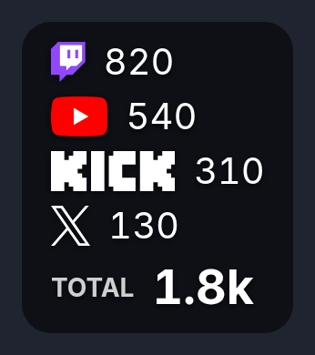
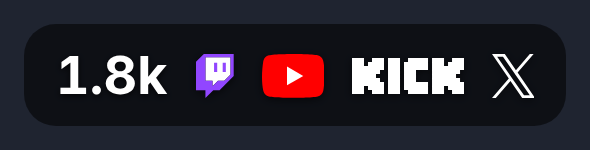

English | [Español](README.es.md)

# Stream Viewers Counter

Shows how many people are watching your stream live, right on screen in OBS.

You see an icon and a count for each platform (Twitch, YouTube, Kick and X), plus a **Total**. When nobody is live, the overlay is invisible.

 

## What you need

- [OBS](https://obsproject.com) (free)
- [Streamer.bot](https://streamer.bot) (free)
- Your [Twitch](https://www.twitch.tv), [YouTube](https://www.youtube.com), [Kick](https://kick.com) and/or [X](https://x.com) accounts

## Download

Download these two files:

- [overlay.html](https://github.com/AndryOre/stream-viewers-counter/releases/latest/download/overlay.html)
- [x-poller.cs](https://github.com/AndryOre/stream-viewers-counter/releases/latest/download/x-poller.cs) (only needed if you want X)

Save them somewhere you will not delete them.

## Step 1: Turn on Streamer.bot's server

1. In Streamer.bot, open **Servers/Clients** and choose **WebSocket Server** (the exact name you see in the menu).
2. Keep the default address and port.
3. Tick **Auto Start**.
4. Click **Start Server**.

## Step 2: Connect your accounts

1. In Streamer.bot, open **Platforms**.
2. Connect Twitch, YouTube and Kick, whichever you use.

## Step 3: Add X (optional)

Skip this step if you do not stream on X.

1. In Streamer.bot, create a global variable named `xHandle`. Set it to your X handle, for example `serudda`.
2. Create a new action named `X Poller`.
3. In that action, add a sub-action: **Execute C# Code**.
4. Open `x-poller.cs` in a text editor, copy everything, and paste it into the sub-action.
5. Click **Compile**.
6. Open **Timed Actions** and add one that runs `X Poller` every 60 seconds.

## Step 4: Add it to OBS

1. In OBS, add a **Browser** source.
2. Tick **Local file**.
3. Click **Browse** and pick `overlay.html`.
4. Set the width and height to 1920 and 1080.

## Customize the look

Add settings to the end of the file path in the **Local file** box. Start with `?` and join several with `&`. Every setting is optional, and a missing or invalid value uses the default.

| Setting   | Default          | What it does                                                                             |
| --------- | ---------------- | ---------------------------------------------------------------------------------------- |
| `style`   | `full`           | `full` or `minimal`. Minimal is one row: the total first, then small logos, no numbers.  |
| `layout`  | `vertical`       | `vertical` or `horizontal`. Overrides the layout of the style.                           |
| `labels`  | `on`             | `on` or `off`. Shows or hides the word "Total". Overrides the style.                     |
| `counts`  | `on`             | `on` or `off`. Shows or hides the number of each platform. Overrides the style.          |
| `color`   | `ffffff`         | Text color, 3 or 6 hex digits without the `#`, for example `ff0000`.                     |
| `bg`      | `000000`         | Background color, same format as `color`.                                                |
| `opacity` | `0.55`           | How solid the background is, from 0 (invisible) to 1 (solid).                            |
| `font`    | `Inter`          | A font installed on your PC. Letters, digits, spaces and hyphens only, up to 60.         |
| `radius`  | `16`             | Corner roundness in pixels, from 0 to 48.                                                |
| `scale`   | `1`              | Size multiplier, from 0.25 to 5. `1.5` makes it 1.5 times bigger.                        |
| `align`   | `top-left`       | Corner: `top-left`, `top-right`, `bottom-left` or `bottom-right`.                        |

### Copy-paste examples

Minimal:

```
C:/Overlays/overlay.html?style=minimal
```

Minimal in the bottom right corner:

```
C:/Overlays/overlay.html?style=minimal&align=bottom-right
```

Red text on a dark blue background:

```
C:/Overlays/overlay.html?color=ff0000&bg=112233&opacity=0.8
```

A different font (it must be installed on your PC):

```
C:/Overlays/overlay.html?font=Montserrat
```

### Advanced: OBS Custom CSS

In the OBS Browser source there is a **Custom CSS** box. Anything you write there is applied on top of the overlay. These names are available: `.pill` (the background box), `.platform` (one platform), `.total` (the Total) and `.count` (a platform number).

Hide the background:

```css
.pill { background: none; }
```

Bigger platform numbers:

```css
.count { font-size: 28px; }
```

Add space between the platforms:

```css
.platform { margin: 6px 0; }
```

## Troubleshooting

**Nothing shows.**
Nobody is live, so the overlay is invisible. If you are live, check that Streamer.bot is open and the server is running (Step 1).

**A platform is greyed out.**
It sent no data for about 2.5 minutes. It also stops counting toward the Total. Check that the account is still connected in Streamer.bot.

**YouTube shows a dash instead of a number.**
Your YouTube channel hides its viewer count. The overlay cannot read it, so YouTube is not counted in the Total.

**X does not show.**
Check that `xHandle` is spelled correctly and that your X profile is live. Also check that the `X Poller` timed action is enabled.

<details>
<summary>For developers</summary>

### Build and test

```sh
bun install
bun run build
bun run check   # typecheck, oxlint, oxfmt
bun test        # unit tests, including a build smoke test
```

The build writes:

- `dist/overlay.html`: a single self-contained file (JS, CSS, icons and the Inter font inlined, no external requests).
- `dist/streamerbot/x-poller.cs`: the X Poller, ready to paste into a Streamer.bot C# action.

The X Poller parser has its own .NET tests: `streamerbot/test.sh`.

### How it works

Data comes from Streamer.bot over its WebSocket server; there is no other server component. When no platform is live the overlay is fully transparent. A platform with no reading for 150 seconds is greyed out and excluded from the Total. Failed or missing readings never show as 0.

### Events

| Platform | Events                                                                            |
| -------- | --------------------------------------------------------------------------------- |
| Twitch   | `Twitch.StreamOnline`, `Twitch.StreamOffline`, `Twitch.ViewerCountUpdate`         |
| YouTube  | `YouTube.BroadcastStarted`, `YouTube.StatisticsUpdated`, `YouTube.BroadcastEnded` |
| Kick     | `Kick.StreamOnline`, `Kick.StreamOffline`, `Kick.ViewerCountUpdate`               |
| X        | `General.Custom` with the X Poller payload                                        |

Several simultaneous YouTube broadcasts are summed by broadcast id. If YouTube hides the concurrent viewer count, the platform is shown without a number and is left out of the Total.

### X payload

X has no API access here, so a Streamer.bot action reads the public logged-out page. It broadcasts the following through `CPH.WebsocketBroadcastJson`:

```json
{ "event": "x-viewers", "live": true, "viewers": 123, "broadcastId": "..." }
```

On a fetch or parse failure it logs a warning and broadcasts nothing, so the overlay falls back to its stale rules.

### Query parameters

Append them to the local file path as a query string, for example `file:///path/to/overlay.html?scale=1.5&align=top-right` (or enter a URL if you host the file).

| Parameter  | Default     | Description                                              |
| ---------- | ----------- | -------------------------------------------------------- |
| `host`     | `127.0.0.1` | Streamer.bot WebSocket host                              |
| `port`     | `8080`      | Streamer.bot WebSocket port                              |
| `password` | none        | Streamer.bot WebSocket password                          |
| `scale`    | `1`         | Size multiplier (0.25 to 5)                              |
| `align`    | `top-left`  | `top-left`, `top-right`, `bottom-left` or `bottom-right` |

The visual settings (`style`, `layout`, `labels`, `counts`, `color`, `bg`, `opacity`, `font`, `radius`) are listed in "Customize the look" above.

If you set a server password in Streamer.bot, pass it with `?password=`. The overlay reconnects automatically when Streamer.bot restarts, and restores the last board from `localStorage` after a reload.

### Release process

1. Bump `version` in `package.json`.
2. Add a matching `## [X.Y.Z]` section to `CHANGELOG.md`.
3. Create a signed tag: `git tag -s vX.Y.Z`.
4. Push the tag: `git push origin vX.Y.Z`.

The Release workflow runs the release gates and publishes `overlay.html` and `x-poller.cs` as release assets, which the download links above point to.

</details>
